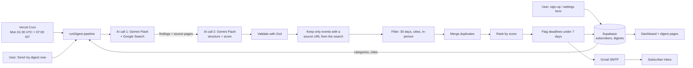

# Event Scout — Components Map

**The diagram (submission format):** [`public/components-map.html`](public/components-map.html), also served at `/components-map.html` on the live site. It follows the course template: actors as rows; Trigger → Input → Context → Processing → AI → Output as columns.

This file is the detail behind the diagram.

## 1. Summary

Event Scout emails each subscriber a ranked list of in-person professional events in their chosen Indian cities for the next 30 days. A Vercel Cron job starts a run every Monday at 7:00 AM IST (subscribers can also start one on demand). Gemini Flash with Google Search finds events on the live web; a second Gemini Flash call turns the findings into structured records and scores each against the subscriber's focus areas. Ordinary code then validates, filters, de-duplicates, ranks and flags registration deadlines. The digest is stored in Supabase, emailed through Gmail SMTP, and shown on the web dashboard.

## 2. Data flow

## 3. Components

| Component | Type | Purpose | Inputs | Outputs | Technology | File | Req. |
|---|---|---|---|---|---|---|---|
| Home page | UI page | Sign-up form, latest digest, run history | Supabase rows | HTML | Next.js server component | `app/page.tsx` | R8, R9, E2 |
| Settings page | UI page | Change cities/focus areas, run on demand, see own digest | Private token in URL | HTML | Next.js | `app/manage/[token]/page.tsx` | R10 |
| Digest page | UI page | Web copy of one emailed digest | Digest id | HTML | Next.js | `app/digest/[id]/page.tsx` | R1, R8 |
| Preferences form | UI component | Multi-select with "All" and "add your own" | User clicks | JSON to API | React client component | `components/PrefsForm.tsx` | R10 |
| Run button | UI component | Starts a run, shows progress | Token | Run result | React client component | `components/RunNow.tsx` | R2 (provable any day) |
| Digest view | UI component | Ranked list, red flags, run log | Digest | HTML | React | `components/DigestView.tsx` | R7, R8, R9, R11 |
| Subscribe API | API route | Create subscriber, or email existing one their link | Name, email, prefs | Private token | Next.js route + Zod | `app/api/subscribe/route.ts` | R10 |
| Preferences API | API route | Save new cities/focus areas | Token, prefs | ok | Next.js route + Zod | `app/api/preferences/route.ts` | R10 |
| Run API | API route | Run pipeline for one subscriber (90 s cooldown) | Token | Digest summary | Next.js route | `app/api/run/route.ts` | R2 |
| Cron API | API route | Run pipeline for every subscriber | `CRON_SECRET` bearer | Per-subscriber results | Next.js route | `app/api/cron/route.ts` | R2 |
| Scheduler | Scheduler | Calls the Cron API weekly | — | HTTP GET | Vercel Cron | `vercel.json` | R2 |
| Pipeline | Service | Orchestrates search → extract → validate → filter → dedupe → rank → flag → store → email | Subscriber | Digest | TypeScript | `lib/pipeline.ts` | R3–R7, R11, E6 |
| Web search | AI call | Find live events across many sites | Cities, focus areas, dates | Findings text + source pages | Gemini Flash + Google Search tool | `lib/gemini.ts` `searchEvents` | R4, E1, E2 |
| Extract and score | AI call | Structure findings, score relevance | Findings, sources, prefs | JSON records | Gemini Flash, JSON schema | `lib/gemini.ts` `extractAndScore` | R7, R9, E1 |
| Email | Service | Render and send the digest | Digest | Email | Nodemailer + Gmail SMTP | `lib/email.ts` | R1, R8, R11 |
| Database | Database | Subscribers, digests, run logs | — | — | Supabase Postgres | `lib/db.ts` | R10 |
| Date helpers | Service | IST dates, day differences | — | — | TypeScript | `lib/dates.ts` | R3, R11 |

## 4. AI components

Both calls use Google Gemini Flash through the official `@google/genai` SDK. The model name is read from `GEMINI_MODEL`. No other AI provider is used anywhere.

### AI call 1 — live web search (`searchEvents`)
- **Purpose:** find real upcoming events wherever they were announced.
- **Input:** today's date, the 30-day window, a group of cities, the focus areas.
- **Tool:** Google Search grounding.
- **Output:** free-text findings, plus the list of web pages Google Search returned (`groundingChunks`) and which sentences each page supports (`groundingSupports`). The code inserts `[S#]` markers into the text from that attribution data.
- **Why AI:** events are spread over many unrelated sites with no shared API. A search-enabled model can query, read and summarise them in one step.
- **Volume:** up to 3 calls per run (cities are grouped), run in parallel.

### AI call 2 — structure and score (`extractAndScore`)
- **Purpose:** turn messy findings into uniform records and judge how well each matches the subscriber.
- **Input:** the marked-up findings, the numbered source list, cities, focus areas, dates.
- **Output schema (enforced with `responseSchema`, re-checked with Zod):**
  `title, start_date, end_date, city, venue, format, organizer, audience, summary, price, registration_deadline, category, relevance_score (0–100), relevance_reason, source_ids[]`
- **Why AI:** reading unstructured text into fields, and judging topical fit plus "will potential clients be in the room", are language-understanding tasks.
- **No search tool here**, so this call can only use what call 1 found.

### What is deliberately *not* AI
The source-URL check, date window, city filter, de-duplication, sort order and the under-7-days flag are plain code, so they are predictable and testable.

## 5. External data sources

| Source | How accessed | Limits |
|---|---|---|
| The live web (Eventbrite, conference sites, NASSCOM, CII, TiE, Meetup, Luma, 10times, public LinkedIn posts and others) | Gemini's Google Search tool | Only pages Google has indexed; free-tier Gemini quota per minute and per day |
| Google redirect links | One `fetch` per source to resolve the real page address | 6 s timeout; falls back to the redirect link |

There are no hardcoded or mock events. Category and city *options* in the form are presets, and users can add their own.

## 6. Known limitations and design decisions

- **LinkedIn:** there is no public LinkedIn API and scraping breaks its terms. LinkedIn event posts are found only when Google has indexed them, so a private or very new post can still be missed.
- **Source link may be a listing page** (for example a "CXO events in Mumbai" page) rather than the event's own page, because we only link to pages the search actually returned.
- **Deadlines:** most organisers do not publish one. If none is stated, the event is labelled "deadline not listed", and flagged when the event itself is under 7 days away.
- **AI can misread a date.** Each event links to its source so the reader can confirm before registering.
- **No passwords.** Each subscriber has a private settings link. A second sign-up with the same email only emails that link to the inbox.
- **Free-tier quotas.** Runs are limited to 4 Gemini calls and a 90-second cooldown per subscriber. If a run fails, the previous good digest stays visible.
- **Vercel Hobby cron** can fire up to an hour late, so the digest arrives between 7:00 and 8:00 AM IST.
- **Supabase key** is used server-side only. Tables are open to that key, so it must stay out of the browser (it does).
- **Digest pages are public by id** so graders can verify output; subscriber emails are masked on public pages.
