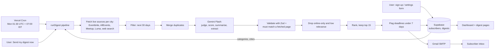

# Event Scout — Components Map

**The diagram (submission format):** [`public/components-map.html`](public/components-map.html), served at `/components-map.html` on the live site. It follows the course template: actors as rows; Trigger → Input → Context → Processing → AI → Output as columns.

This file is the detail behind the diagram.

## 1. Summary

Event Scout emails each subscriber a ranked list of in-person professional events in their chosen Indian cities for the next 30 days. A Vercel Cron job starts a run every Monday at 7:00 AM IST (subscribers can also start one on demand). The app fetches live event listings from Eventbrite, AllEvents, Meetup and Luma for each city, plus web-search results that cover conference sites, industry bodies and public LinkedIn posts. Code filters by date and merges duplicates. Gemini Flash then judges each event, scores it against the subscriber's focus areas, writes the summary, and extracts dated events from search snippets. Code validates the AI output, ranks, and flags registration deadlines. The digest is stored in Supabase, emailed through Gmail SMTP, and shown on the web dashboard.

## 2. Data flow

## 3. Components

| Component | Type | Purpose | Inputs | Outputs | Technology | File | Req. |
|---|---|---|---|---|---|---|---|
| Home page | UI page | Sign-up form, latest digest, run history | Supabase rows | HTML | Next.js server component | `app/page.tsx` | R8, R9, E2 |
| Settings page | UI page | Change cities/focus areas, run on demand, see own digest | Private token in URL | HTML | Next.js | `app/manage/[token]/page.tsx` | R10 |
| Digest page | UI page | Web copy of one emailed digest | Digest id | HTML | Next.js | `app/digest/[id]/page.tsx` | R1, R8 |
| Preferences form | UI component | Multi-select with "All" and "add your own" | User clicks | JSON to API | React client component | `components/PrefsForm.tsx` | R10 |
| Run button | UI component | Starts a run, shows progress | Token | Run result | React client component | `components/RunNow.tsx` | R2 (provable any day) |
| Digest view | UI component | Ranked list, red flags, run log | Digest | HTML | React | `components/DigestView.tsx` | R7, R8, R9, R11 |
| Subscribe API | API route | Create subscriber, or email an existing one their link | Name, email, prefs | Private token | Next.js route + Zod | `app/api/subscribe/route.ts` | R10 |
| Preferences API | API route | Save new cities/focus areas | Token, prefs | ok | Next.js route + Zod | `app/api/preferences/route.ts` | R10 |
| Run API | API route | Run pipeline for one subscriber (90 s cooldown) | Token | Digest summary | Next.js route | `app/api/run/route.ts` | R2 |
| Cron API | API route | Run pipeline for every subscriber | `CRON_SECRET` bearer | Per-subscriber results | Next.js route | `app/api/cron/route.ts` | R2 |
| Scheduler | Scheduler | Calls the Cron API weekly | — | HTTP GET | Vercel Cron | `vercel.json` | R2 |
| Source aggregation | Service | Fetch and parse live listings and search results | Cities, focus areas | Candidates with real URLs, per-source report | `fetch`, schema.org JSON-LD parsing, RSS parsing | `lib/sources.ts` | R4, E2, E6 |
| Pipeline | Service | Orchestrates fetch → filter → dedupe → AI → validate → rank → flag → store → email | Subscriber | Digest | TypeScript | `lib/pipeline.ts` | R3, R5–R7, R11, E6 |
| Assess events | AI call | Judge, score, summarise; extract events from snippets | Candidates, prefs | JSON records | Gemini Flash, JSON schema | `lib/gemini.ts` `assessEvents` | R5, R7, R9, E1 |
| Organiser contact | Service | For each event in the digest, read the event page and the organiser's profile page and keep the contact details they publish: name, email, phone, LinkedIn, website, organiser page | Final events | `contact` on each event | `fetch` + schema.org and pattern parsing, no paid service | `lib/contact.ts`, `lib/links.ts` | R9 |
| Organiser LinkedIn fallback | External API | Where the pages gave no LinkedIn link, look up the organiser's company page | Organiser names | LinkedIn company URL | Lusha free credits, cached in Supabase `organizers`, max 3 new lookups per run | `lib/lusha.ts` | R9 |
| Email | Service | Render and send the digest | Digest | Email | Nodemailer + Gmail SMTP | `lib/email.ts` | R1, R8, R11 |
| Database | Database | Subscribers, digests, run logs | — | — | Supabase Postgres | `lib/db.ts`, `supabase/schema.sql` | R10 |
| Date helpers | Service | IST dates, day differences | — | — | TypeScript | `lib/dates.ts` | R3, R11 |

## 4. AI components

There is one AI call per run. It uses Google Gemini Flash through the official `@google/genai` SDK. The model name is read from `GEMINI_MODEL`; if that model is rate-limited or overloaded, the code falls back to other Gemini Flash models listed in `GEMINI_FALLBACK_MODELS`. No other AI provider is used anywhere.

### `assessEvents` — understand and score
- **Input:** up to 40 listed events (name, date, city, venue, organiser, price, description, site) and up to 20 web-search snippets, plus the subscriber's cities and focus areas.
- **What Gemini does:**
  1. Decides whether each listed event is a professional event or consumer noise (concerts, hobby classes).
  2. Scores it 0–100 for fit with the focus areas and the likelihood that potential clients are in the room, with a one-sentence reason.
  3. Writes the short summary and "who's there" line.
  4. Reads unstructured search snippets and extracts an event only when a specific date and target city are stated.
  5. Reports a registration deadline only if the text explicitly states one.
- **Output schema** (enforced with `responseSchema`, re-checked with Zod):
  - `listed[]`: `id, is_professional_event, relevance_score, relevance_reason, category, audience, summary, format, registration_deadline`
  - `from_search[]`: `id, title, start_date, end_date, city, venue, organizer, price, audience, summary, format, registration_deadline, category, relevance_score, relevance_reason`
- **Why AI is needed:** judging topical fit, guessing audience seniority from a description, summarising, and reading dates out of free text are language-understanding tasks that rules cannot do well.
- **Guardrail:** Gemini returns only an `id` for each event. Name, date, venue and URL of listed events are taken from the fetched page, not from the model, so it cannot invent or alter them. A record whose id does not match a fetched item is dropped.

### What is deliberately *not* AI
Fetching, the 30-day window, de-duplication, the "tied to a fetched page" check, sort order, the top-15 cut and the under-7-days flag are plain code, so they are predictable and testable.

## 5. External data sources (all fetched live on every run)

| Source | How accessed | What we read | Limits |
|---|---|---|---|
| Eventbrite | Public city listing page `eventbrite.com/d/india--{city}/business--events/` | schema.org `Event` JSON-LD | First page only; no official search API exists |
| AllEvents | `allevents.in/{city}/business` and `/conferences` | JSON-LD | First page; some city names differ |
| Meetup | `meetup.com/find/` (career and business category) | JSON-LD | First page |
| Luma | `lu.ma/{city}` | JSON-LD | Only cities Luma has a page for |
| Web search | Bing RSS results, two queries per city (general, and `site:linkedin.com`) | Title, link, snippet | Only indexed pages; snippets often lack a date |

| Lusha | Company API, by organiser name | LinkedIn company page and domain only | Free plan has 40 credits; results are cached and a run makes at most 3 new lookups |

A failing source is recorded in the run log and does not stop the run. There are no hardcoded or mock events. Category and city *options* in the form are presets, and users can add their own.

## 6. Known limitations and design decisions

- **Why not Gemini's Google Search tool:** it was the first design, but the free-tier API key returns "quota exceeded" for search grounding on every Flash model. The app therefore fetches sources itself and uses Gemini only to interpret them.
- **LinkedIn:** there is no public LinkedIn API and scraping breaks its terms. LinkedIn posts are reached only through web search, where snippets rarely state a date, so LinkedIn-only events can still be missed.
- **iSpirit and individual conference sites** have no feed. They are covered only through web search.
- **Deadlines:** most organisers do not publish one. If none is stated, the event is labelled "deadline not listed", and flagged when the event itself is under 7 days away. Events whose stated deadline has passed are removed.
- **Custom cities** typed by a user work only where the listing sites use the same name.
- **No passwords.** Each subscriber has a private settings link. A second sign-up with the same email only emails that link to the inbox.
- **Free-tier quotas.** One Gemini call per run and a 90-second cooldown per subscriber. If a run fails, the previous good digest stays visible. A run takes one to two minutes.
- **Vercel Hobby cron** can fire up to an hour late, so the digest arrives between 7:00 and 8:00 AM IST.
- **Supabase key** is used server-side only. Tables are open to that key, so it must stay out of the browser (it does).
- **Digest pages are public by id** so graders can verify output; subscriber emails are masked on public pages.
- **Organiser contact:** only details printed on the event page or the organiser's profile are shown, so some events have a full contact and some have only the organiser page. Where nothing is published the digest says so. Email and phone are shown in the email and on the digest's own page, but left off the public home page. Lusha is a fallback for the LinkedIn company page only and stops when its free credits run out.
